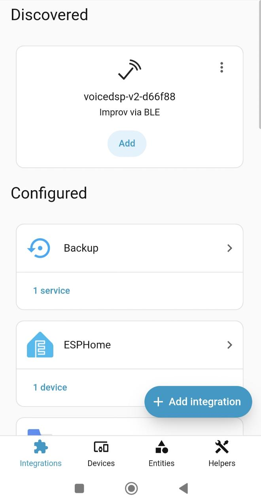

# Your Home Assistant, with a voice

**Voice DSP+ V2 + ZeroCore S3** brings local wake-word detection, music, spoken
answers and hands-free controls to Home Assistant. Use your own speakers or
the corresponding Voice Compact / Full Speaker assembly.

[Quick start: Voice Compact](#quick-start-voice-compact) |
[Prepare a DIY board](#prepare-a-diy-or-unprovisioned-board) |
[Download 0.6.75 r8](Firmware/README.md) | [ESPHome sources](Sources/README.md) |
[All three setups](../README.md)

## Quick start: Voice Compact

If your Voice Compact already runs the BLE-enabled Home Assistant firmware,
just plug it in. You do not need to flash it or connect it to a computer.

1. Power on your **Voice Compact** and turn on Bluetooth on your phone.
2. Open the **Home Assistant** mobile app. Go to **Settings > Devices & services**.
   Under **Discovered**, look for **`voicedsp-v2-xxxxxx`**, labeled **Improv via BLE**.
   The suffix is different for each unit.
3. Tap **Add** on that card, then enter the name and password for your **2.4 GHz
   Wi-Fi** network and submit.

Once the device joins Wi-Fi, accept the **ESPHome** discovery in the same menu
if prompted. Select your Assist pipeline, wait for **Diagnostic - XMOS firmware
status: Ready**, then try **Hey Jarvis**. Start with a low playback volume.

**Don't see it?** For this discovery screen, your Home Assistant instance needs
a working [Bluetooth integration](https://www.home-assistant.io/integrations/bluetooth/)
and an adapter or a [Bluetooth proxy](https://www.home-assistant.io/connectivity/bluetooth/)
that supports connections and is within range. Bluetooth on the phone alone
does not replace that connection. On r8, a device without saved Wi-Fi advertises
for ten minutes after startup; power-cycle it to reopen that window. If Wi-Fi
is already configured, look for **ESPHome** instead. If BLE is unavailable,
use the **VoiceDSP V2 Setup** access point (password `voicedsp-setup`) or serial
Improv via the ZeroCore USB port.

## Prepare a DIY or unprovisioned board

1. With power off, mount **RASPIAUDIO ZeroCore S3** on **Voice DSP+ V2**.
   You need Home Assistant, 2.4 GHz Wi-Fi and a USB data cable. Remove any Pi.
2. If XMOS is blank or runs USB-only firmware, provision persistent I2S with
   [Safe Recovery](https://apps.raspiaudio.com/#device=ZeroCoreS3&application=USBRecovery)
   first. Then connect the **ZeroCore USB data port**, not XMOS, for this installation.
3. Open [RASPIAUDIO Apps: V2 installer](https://apps.raspiaudio.com/#device=ZeroCoreS3&application=VoiceDSPV2)
   in Chrome/Edge. ZeroCore S3 / Voice DSP+ V2 **0.6.75 r8** is preselected.
   Connect and Install. An erased install removes saved settings.
4. Configure Wi-Fi with serial Improv through the installer or follow the
   [Bluetooth quick start](#quick-start-voice-compact) above. Then add the device
   through ESPHome and select your Assist pipeline.

Manual fallback: download the [factory image](Firmware/voicedsp-v2-0.6.75-r8-ble.factory.bin)
and select it in [ESPHome Web](https://web.esphome.io/). The web installer and
this download use identical release binaries.

## New in r8

The owner validated idle DOA, output memorization and the Home Assistant timer.
BLE no longer replaces the normal startup sequence. Boot restores the saved
output; accepted settings commit after the idle/debounce gate. Choosing a new
product mode still applies that preset's output. AEC/filter tuning is unchanged.
[Release notes and known limits](Firmware/RELEASE-r8.md).

## Everything on the device page

### New in 0.6.75: a clearer native device page

No dashboard import or extra configuration: the firmware supplies the names and
categories at discovery. Existing installations may need an ESPHome integration
reload to refresh HA's cached metadata; custom names/overrides remain user-owned.

| Native section | What you find |
| --- | --- |
| Controls | **Outputs - Audio Output**, main volume and daily actions |
| Sensors | **Inputs - PAJ Motion**, USB-C PD contract, voltage, current and power |
| Configuration | Settings grouped by **Outputs**, **Inputs**, **Assistant** prefixes |
| Diagnostic | Firmware, power, microphone and troubleshooting information |
| Assist | Home Assistant's native voice satellite |

PAJ Motion indicates a recognized gesture for two seconds, not presence. PD Power
is the available negotiated contract power, not measured consumption. HA controls
the native sections and ordering; firmware cannot add arbitrary custom sections.
The owner accepted this UI; source and live checks confirm AEC/filter preservation.

### Retained from 0.6.69

**Dismiss a ringing timer with any detected gesture**, including wave or circles.
Gesture Control must be enabled. The gesture stops only the alarm, not the
underlying music, and does not change volume or speaker mute. A one-second guard
prevents hand withdrawal from triggering another action. Countdown timers are
not cancelled. Native tests and installation checks pass; physical gesture
dismissal acceptance is still pending. AEC, XMOS and wake models are unchanged.

### Included from 0.6.68

- **PAJ recovery:** repeated mute/unmute validated; a transient sensor NACK no
  longer inherits a 30-second wait from previous initialization failures.
- **Wake Word:** Hey Jarvis (default), Okay Nabu or Hey Mycroft.
- **Action / right button:** dismiss timer, interrupt Assist, pause music or
  start listening, according to the current state.
- **LED Ring:** brightness/color controls and a two-second volume gauge.
- Voice PE confirmation sounds, timer countdown/alarm animations, and response
  options under **Stop Word Mode**. Existing mono AEC settings are preserved.

Owner validated repeated gestures; API checks cover controls and timer actions.
Alternate wake words and spoken Stop during replies still need acoustic testing.
This is not a new long-duration or AEC performance qualification.

No custom dashboard or admin token is required. Open the ESPHome device in HA.

| Product Mode | Best for |
| --- | --- |
| **Voice Compact** | Small internal speakers and a compact voice interface |
| **Full Speaker** | Separate external L woofer / R tweeter with a matched crossover |
| **Custom** | Explicit output, level and tone settings |

Select a mode: it applies automatically when audio is idle, and settings are
saved automatically. Full Speaker filter changes also wait for idle. No separate
Apply/Save button is needed. Internal/external general gains are **0 dB**, hidden
by default; **Outputs - Volume** remains the daily volume control. Start low after
updating. Hardware amplifier gain and per-driver filter trims remain independent.

Daily controls include speaker/microphone mute, output, bass/treble, gesture
enable (default ON), wake sensitivity and Stop behavior. Buttons, gestures,
startup/wake/mute sounds and listening/thinking/replying LED states are retained.
Gesture mute is **speaker mute**, not microphone privacy mute.

Geometry, power diagnostics, amplifier fault, firmware status and troubleshooting
controls remain available. **Show Advanced Settings / Show Diagnostics** are
helper entities; the standard HA device page does not dynamically collapse its
entity list. No radar or ambient-light sensor is claimed.

> **External / Full Speaker require USB-C PD directly on Voice DSP+.**
> A 65 W or higher supply is recommended. Do not feed multiple supplies through
> the shared power header. Full Speaker: **L = woofer, R = tweeter**. Retain a
> protective series capacitor. The editable 9500 Hz / L 0 dB / R -6 dB preset is
> for the tested speaker, not every tweeter. Never select unfiltered External for
> a bare tweeter.

## Who does what?

- **ESP32:** local Hey Jarvis, Home Assistant connection and media.
- **XMOS:** four-microphone processing, AEC, noise suppression and LED DOA.
- **Home Assistant:** your speech-to-text, conversation and TTS pipeline.

Speech services can be local or cloud-based, depending on your HA configuration.
Internal square or external LINE/SQUARE arrays are selected at startup.
[Hardware and wiring](../Raspberry%20Pi/Documentation/hardware.md).

## Updates and recovery

The ESP32 includes matching XMOS payloads but routine startup **resumes the
persistent I2S image already installed in XMOS QSPI**, without a RAM upload.
Blank or USB-only boards require Safe Recovery (I2S) first.

**Install XMOS in Flash** explicitly performs persistent installation.
**Reload embedded XMOS firmware** is temporary RAM recovery, not a QSPI update.
Do not substitute standalone USB firmware for this paired I2S configuration.

**Diagnostic - ESP32 + XMOS Firmware** offers r8 directly in HA, without an
ESPHome server. Stable and beta catalogs offer the same version. Checks run
after networking starts and every six hours; press **Diagnostic - Check firmware
updates** for an immediate check. Installation is manual, and no phone notification
is guaranteed. A board already on r8 is up to date. This ESP32 update does not
change XMOS; future XMOS updates must follow their persistent-install instructions.
See [manual OTA instructions](Firmware/README.md).

If the controller remains unavailable, stop audio and remove all power for ten
seconds. Do not add a second I2C owner or repeatedly reload a blocked bus.

This accepted development release retains unencrypted LAN API/OTA and opt-in
capture diagnostics. Use a trusted LAN, never expose its ports to the Internet.
No home Wi-Fi credentials or private recordings are included. AEC and filter
parameters remain those of the accepted HA checkpoint, not later Pi profiles.
