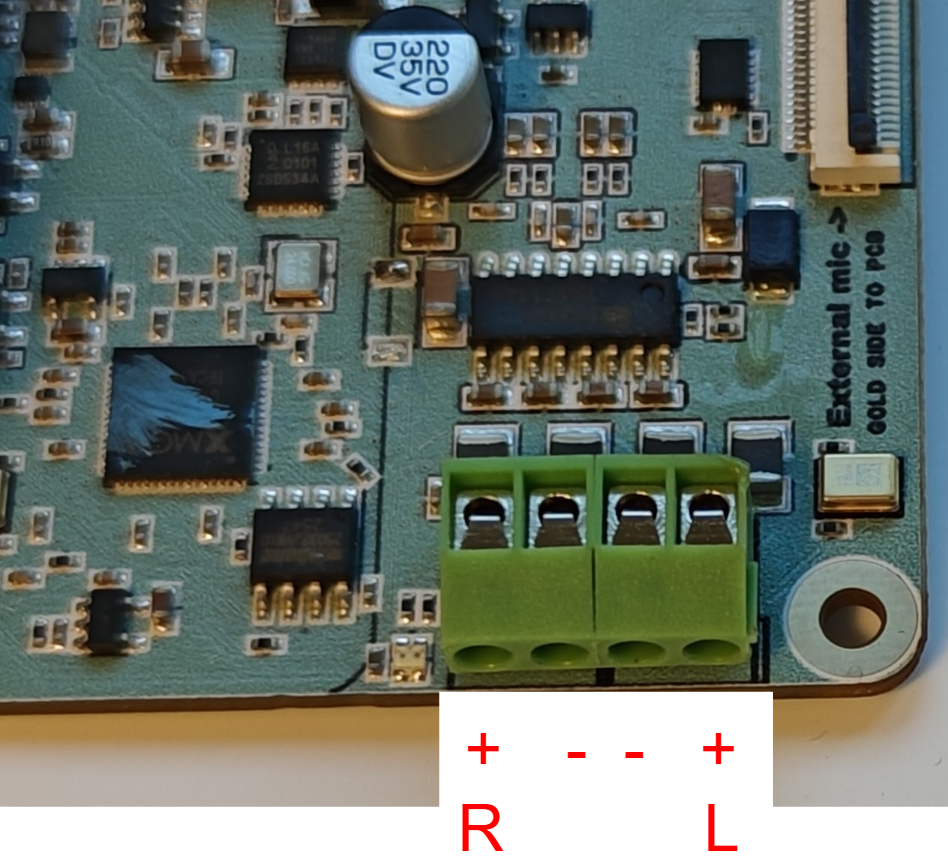
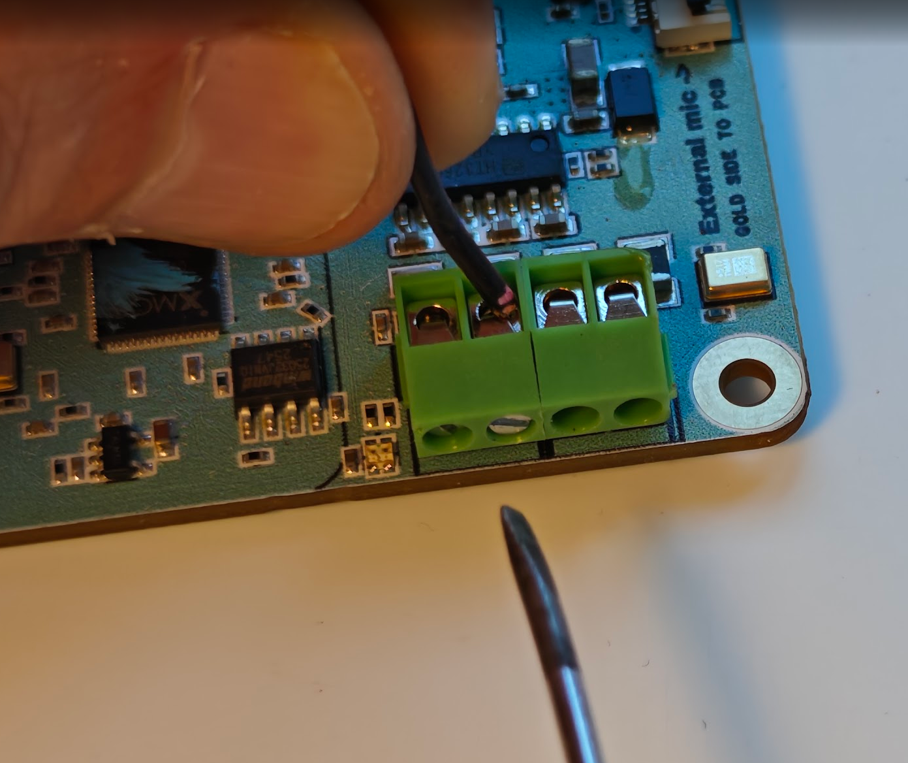
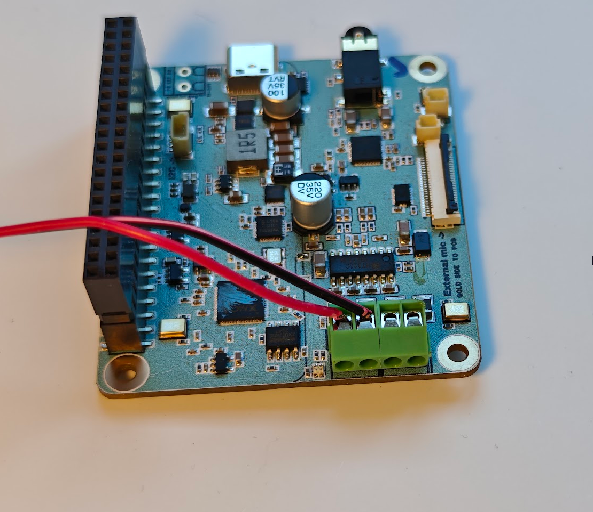

# Hardware, arrays and speakers

This guide describes **Voice DSP+ V2**, not the original PI AI MIC board.
The connector mapping below describes the V2.02 reference; check the actual
board revision before wiring. See the [physical pinout](pinout.md).

## Choose a system

| Form | Intended use |
| --- | --- |
| Voice DSP+ board | USB audio, Pi HAT, or ZeroCore S3 voice satellite; supply your enclosure/speakers |
| Voice Compact | Integrated small-speaker/microphone enclosure; HA variant also needs ZeroCore S3 |
| Voice Full Speaker | Larger matched speaker assembly with separate woofer/tweeter paths; HA variant also needs ZeroCore S3 |

These are product forms, not interchangeable firmware files. Check the actual
contents of a kit before assuming ZeroCore, charger or arrays are included.
[Product family](https://raspiaudio.com/voicedsp/) and
[Voice DSP+ board](https://raspiaudio.com/product/voicedsp/).

## Microphones

Four onboard microphones form a square. An external ribbon array replaces them
as the active four-microphone source; it does not create an eight-microphone mode.
Source and LINE/SQUARE geometry are detected at startup. Power off before changing
the ribbon and reboot afterwards; do not assume live geometry switching.

| Array | Why choose it | Limitation |
| --- | --- | --- |
| Onboard SQUARE | Compact, no extra ribbon, directions around the device | Enclosure and nearby speaker coupling matter |
| [External SQUARE](https://raspiaudio.com/product/voicedsp-square-array/) | Place the array away from electronics/speaker; around-device direction coverage | Ribbon/orientation and acoustic openings must be correct |
| [External LINE](https://raspiaudio.com/product/voicedsp-line-array/) | Long narrow front edge, screen or wall-facing product | Linear geometry has front/back ambiguity; not equivalent to 360-degree square |

Current firmware geometry references are square corners at +/-22 mm and a line
with 33 mm microphone spacing. Do not reuse those constants for another array.
The array/AEC tests cover the tested external arrays, not every enclosure.
The USB DOWN long press
changes **speakers**, not microphone source.

## Speaker connections

| Connector | Function | CAD pad nets |
| --- | --- | --- |
| CN3 | Small internal left speaker, tested 8 ohm | 1 = DAC_SPK_L_N, 2 = DAC_SPK_L_P |
| CN4 | Small internal right speaker, tested 8 ohm | 1 = DAC_SPK_R_N, 2 = DAC_SPK_R_P |
| P2 | External left amplifier | 1 = HPL-, 2 = HPL+ |
| P1 | External right amplifier | 1 = HPR+, 2 = HPR- |

**P1 and P2 have opposite CAD pad polarity order.** Follow printed +/- markings
and net names, not an assumed 'pin1 always positive'. External outputs are bridged:
neither speaker wire is ground. Never join the negative terminals, tie L/R together,
or feed these amplified outputs into a powered speaker's line input. Use the jack
for a compatible powered speaker/headphone/line connection.

Use appropriate 4 or 8 ohm passive speakers on external channels. A full-range
speaker or an enclosure with its own passive crossover can use flat external mode.
Do not directly parallel two 4 ohm drivers into a 2 ohm load. Do not connect a
70/100 V distributed-audio speaker without a suitable interface.

### Connect a passive external speaker

**1. Disconnect power and identify the pair.** With the board oriented as in
this photo, the green terminal reads **R+ | R- | L- | L+** from left to right.
For one 4 or 8 ohm passive full-range speaker, use either complete pair and
leave the other pair empty. Match the speaker's `+` and `-` markings; do not
wire across the two channels or share a return.

**2. Secure both wires.** With power still disconnected, open each terminal
clamp with a small screwdriver, insert the stripped end in the wire opening,
then secure it. Tug gently to check the connection and make sure no bare strand
can touch the next terminal.

**3. Check the wiring, then select External.** In this example, red is on
**R+** and black is on **R-**; the L pair is empty. For Raspberry Pi, plug
[USB-C PD into Voice DSP+ only](#power), then select **External** in
[Voice DSP+ Output](../README.md#choose-where-the-sound-plays) and test at low volume.

### Full Speaker: separate woofer and tweeter

For the measured two-way enclosure: **red/black woofer wires -> L (P2)**;
**tweeter -> R (P1)**. Select Full Speaker, not flat external. Both channels carry
the same mono program through different frequency filters, not stereo music.
The current bench assembly has no tweeter series capacitor. Its protection depends
on correct software routing: an independent passive safety capacitor is advisable
for development, but adding it changes the acoustic response and needs remeasurement.

Accepted Pi Full Speaker: LR4 9500 Hz, woofer trim 0 dB, tweeter trim -6 dB.
This is one assembly's measured setting, not a recommendation for unknown tweeters.
Driver power handling and available supply limit usable volume; amplifier maximum
ratings are not a guarantee of distortion-free output or the rating of the small speakers.

## Power

For a Pi plus high-power external speaker configuration, recommend a PD65 W or
higher supply offering 20 V into Voice DSP+ USB-C, with a suitable cable. The
regulated 5 V header powers the Pi. See [Pi power instructions](../README.md).
External / Full Speaker require USB-C PD directly on Voice DSP+. Disconnect
the Pi USB-C supply; never power both USB-C inputs at once. Ordinary USB 5 V
is not the supported external-amplifier supply configuration.
Power Good is exposed as diagnostic in this development reference; absence of
an interlock does not guarantee unlimited power. Do not raise volume into clipping.
