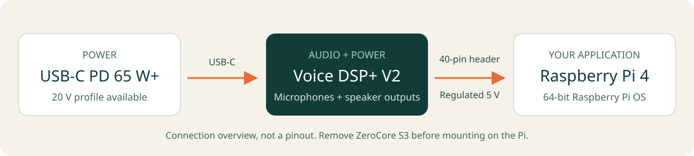
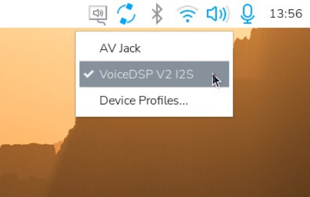
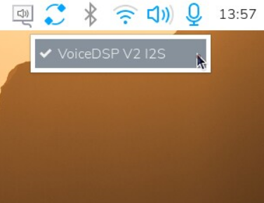
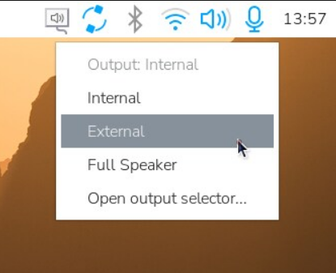
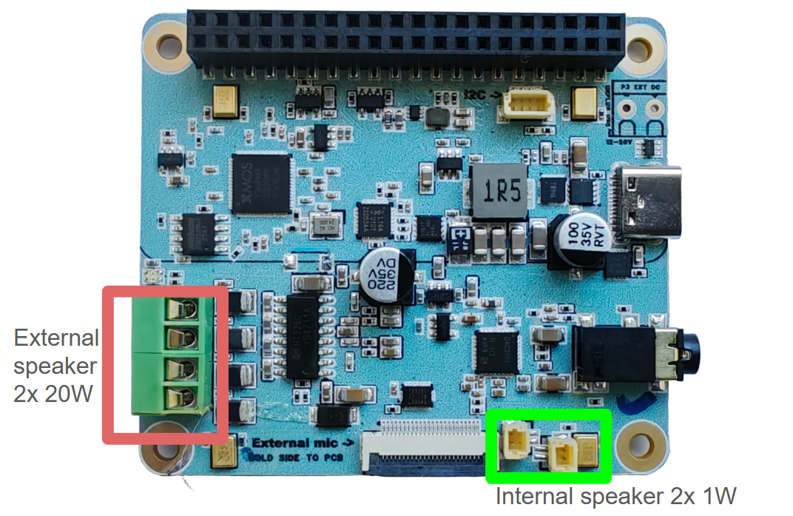

[Voice DSP+ V2](../README.md) / Raspberry Pi

# Give your Raspberry Pi a voice

**Four microphones. Your choice of speakers. Familiar desktop audio controls.**

Voice DSP+ performs microphone processing and AEC; your Pi runs the application.
The 48 kHz kit provides processed mono capture, mono program playback and the
validated AEC policy on internal and external outputs.

**[Download the installer](Firmware/voicedsp-v2-pi48-r8.run)** |
[Checksums and firmware](Firmware/README.md) | [Source code](Sources/README.md)

## 1. Connect



Use a **Pi4 Model B with 64-bit Raspberry Pi OS** and a normal desktop user.
Power off, align the 40-pin header and mount Voice DSP+ V2. Remove ZeroCore S3:
the Pi must be the only bus host. See the [pinout](Documentation/pinout.md).

> **External / Full Speaker: USB-C PD directly on Voice DSP+ is required.**
> Use a 65 W or higher charger offering a 20 V profile and a suitable cable.
> Voice DSP+ supplies the Pi through the header. Disconnect the Pi USB-C supply
> before powering on. Never connect both USB-C supplies at once.

## 2. Download

Download the installer and checksum on the Pi:

```sh
curl -fL 'https://raw.githubusercontent.com/RASPIAUDIO/Voice-DSP-Plus/V2/Raspberry%20Pi/Firmware/voicedsp-v2-pi48-r8.run' -o voicedsp-v2-pi48-r8.run
curl -fL 'https://raw.githubusercontent.com/RASPIAUDIO/Voice-DSP-Plus/V2/Raspberry%20Pi/Firmware/voicedsp-v2-pi48-r8.sha256' -o voicedsp-v2-pi48-r8.sha256
sha256sum -c voicedsp-v2-pi48-r8.sha256
```

The installer contains the paired image, host sources and software tests.
No Git account, XMOS SDK or XTAG is needed.

## 3. Install and reboot

On a fresh Pi audio setup:

```sh
sudo bash ./voicedsp-v2-pi48-r8.run --confirm-v2-exclusive --desktop --reboot
```

Save your work first. This installs dependencies, compiles/tests the controller,
adds the overlay and reboots. Setup continues after reboot with audio discovery
and AEC readback verification. Existing installations or conflicting overlays
are preserved rather than overwritten.

```sh
journalctl -u voicedsp-v2-48k-setup.service -b --no-pager
```

Look for **`SUCCESS: accepted AEC verified`**. XMOS loads into RAM at each boot;
QSPI is not rewritten. This is an audio kit, not a bundled wake-word or HA app.

## 4. Use it like a sound card

After reboot, the desktop setup makes Voice DSP+ the default audio device.
To check or change it, use the icons in the **top-right panel**:

### Select the speaker and microphone

**Playback:** right-click the **speaker** icon and select **VoiceDSP V2 I2S**.



**Recording:** right-click the **microphone** icon and select **VoiceDSP V2 I2S**.



### Choose where the sound plays

Open **Voice DSP+ Output**, the speaker-in-a-screen icon at the **far left of
the tray icons shown below**, and choose **Internal**, **External** or
**Full Speaker**. This changes the physical output without changing the
**VoiceDSP V2 I2S** device in Raspberry Pi OS. You can also open the selector
from the application menu. External and Full Speaker ask you to confirm PD wiring.



| Output | Connector and use |
| --- | --- |
| **Internal** | The two small **CN3/CN4** stereo speaker connectors, outlined in green and labeled **2 x 1 W** in the photo. The Pi kit was tested with 8 ohm loads. |
| **External** | The large **green screw terminal** (P1/P2), outlined in red below. Connect suitable 4 or 8 ohm passive full-range speakers or an enclosure with its own passive crossover. |
| **Full Speaker** | The **same green terminal**, not a third connector. The matched [Voice DSP Full Speaker](https://raspiaudio.com/product/voicedsp-speaker/) profile splits one mono signal with an active crossover: **L = woofer**, **R = tweeter**. This is not a stereo pair. |



The photo's **2 x 20 W** label identifies the external terminal. The [published
amplifier capability](https://raspiaudio.com/product/voicedsp/) is **up to 2 x 25 W**
with 4 ohm speakers and a suitable 20 V PD supply, not guaranteed continuous power.
See [speaker wiring and polarity](Documentation/hardware.md#speaker-connections).

> **External / Full Speaker:** connect USB-C PD directly to Voice DSP+
> (65 W or more recommended, with a 20 V profile). Do not also power the Pi
> through its own USB-C port.

**Never select unfiltered External for a bare tweeter.** Full Speaker's LR4
9500 Hz / 0 and -6 dB trims belong to the tested assembly, not a universal preset.

### Try a short recording

Start quietly. At core boot the output is OFF/-30 dB; desktop startup then
selects Internal at hardware 0 dB, with the desktop volume initially at 25%.
This Pi kit remembers desktop volume, not the output route. Left-click the
system audio icons for volume or mute.

```sh
arecord -r 48000 -c 1 -f S16_LE -d 8 my-voice.wav
aplay my-voice.wav
```

## Controls and development

[AEC / DOA / raw captures](Documentation/raspberry-pi-controls.md) |
[Arrays and wiring](Documentation/hardware.md) |
[40-pin pinout](Documentation/pinout.md) |
[Build/test sources](Sources/README.md) |
[Release scope](Documentation/release-notes.md)

Numeric DOA and arbitrary NS/NN tuning are not yet exposed in the Pi CLI.
Raw capture offers channels0/1, not four simultaneous raw microphones.

## Existing kit or headless Pi?

For a desktop-only update, stop playback and run from the `Raspberry Pi` folder
of this checkout:

```sh
sudo python3 Sources/scripts/desktop.py install --user "$USER"
```

This updates managed desktop files without reflashing/replacing the controller.
Audio services restart briefly. Relaunch Voice DSP+ Output or log out/in.
For a new headless kit, omit `--desktop`; select the output manually afterwards.

To remove desktop integration first, then the core (managed files must be unchanged):

```sh
sudo python3 /opt/voicedsp-desktop/desktop.py remove
sudo systemctl stop voicedsp-v2-48k.service
sudo python3 /opt/voicedsp-v2-48k/scripts/install.py uninstall --execute --confirm-v2-exclusive
```

Reboot after removing the overlay. No other audio driver is automatically removed.
